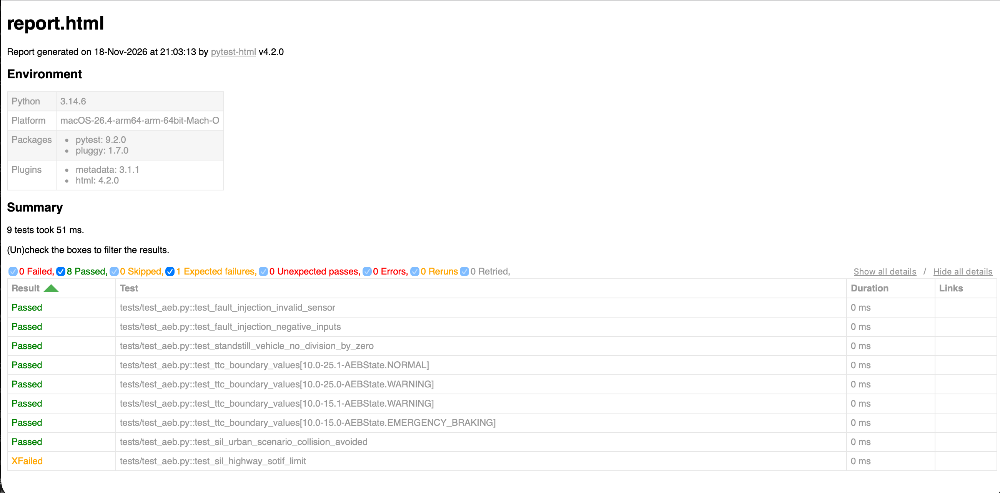

# AEB System — Software-in-the-Loop (SIL) Test Framework

A Python test suite and closed-loop simulation verifying the decision logic of an **Autonomous Emergency Braking (AEB)** controller against functional and safety requirements.

## System Requirements (SUT)
* **REQ-01 (Fault Handling):** Transition to `FAULT_DEGRADED` when radar signal is invalid (`sensor_valid == False`) or physical inputs are negative.
* **REQ-02 (Standstill Safety):** Remain in `NORMAL` state when `ego_speed == 0 m/s` (avoiding division-by-zero exceptions).
* **REQ-03 (Safe Cruise):** Remain in `NORMAL` when Time-To-Collision `TTC > 2.5s`.
* **REQ-04 (Driver Warning):** Transition to `WARNING` when `1.5s < TTC <= 2.5s`.
* **REQ-05 (Emergency Braking):** Activate `EMERGENCY_BRAKING` when `TTC <= 1.5s`.

## Verification Scope
* **State Machine & Fault Injection:** Unit tests validating transitions and degraded mode activation upon sensor failure.
* **Boundary Value Analysis (BVA):** Precision checks at threshold edges (`TTC = 2.50s` vs `2.51s`, and `TTC = 1.50s` vs `1.51s`).
* **Closed-Loop SIL Simulation:** Time-stepped physics loop (`dt = 0.1s`, deceleration `8.0 m/s²`) verifying collision avoidance (`remaining_distance > 0.5m`) in urban scenarios (`54 km/h`).
* **SOTIF Limit Analysis (ISO 21448):** Dedicated `XFAIL` scenario documenting the Operational Design Domain (ODD) boundary at highway speed (`108 km/h`), where braking physics cannot prevent impact under static `TTC = 1.5s` thresholds.

## Project Structure
```text
aeb-sil/
├── .github/workflows/
│   └── tests.yml           # GitHub Actions CI pipeline
├── docs/
│   └── test_report.png     # Sample pytest-html execution report
├── src/
│   └── aeb_controller.py   # AEB state machine and TTC calculation
├── tests/
│   └── test_aeb.py         # Pytest suite (Unit, BVA, SIL, SOTIF)
├── .gitignore
├── pytest.ini              # Default pytest & HTML report configuration
├── requirements.txt        # Pinned dependencies
└── README.md
```

## Quick Start
Install dependencies and run the test suite (automatically generates `report.html` via `pytest.ini`):

```bash
pip install -r requirements.txt
python -m pytest
```

## Test Execution Report
Sample output generated by `pytest-html`:


